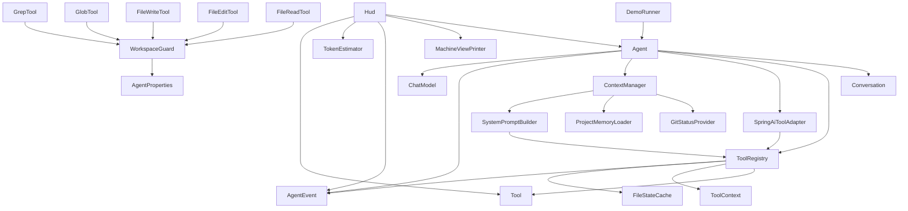

# AGENTS.md — описание проекта и правила работы в нём

Этот файл — точка входа для AI-агента (и для человека-разработчика): что это за
проект, как он устроен, что здесь можно и чего нельзя. Разделы 1–4 читать перед
первой правкой, 6–8 — перед сдачей работы.

## 1. Что это за проект

`ai-harness` — учебный кодинг-агент: терминальное приложение на Spring Boot,
которое получает задачу на русском, читает и правит локальный репозиторий через
инструменты, а «думает» локальной моделью `qwen3.5:4b` через Ollama. Веб-слоя
нет (`spring.main.web-application-type: none`), весь диалог — консоль и HUD
в стиле T-800.

Проект растёт от урока к уроку: каждый урок добавляет одну подсистему. Поэтому
часть кода **намеренно** недоделана — это следующие уроки, а не забытый код.
Текущее состояние — после урока 6 (ветка `master`, последний коммит `les6`).

Работает сегодня:

- агентский цикл «модель → инструменты → модель» с лимитом итераций (20);
- 5 инструментов — `Read`, `Write`, `Edit`, `Glob`, `Grep` — и рабочая папка как
  песочница для всех;
- системный промпт: статические правила + динамический контекст (окружение, git,
  `HARNESS.md`), собранный один раз на сессию;
- события хода и HUD, подписанный на них;
- грубая оценка размера контекста в токенах.

Ещё не реализовано (следующие уроки): `Bash` и разрешения
([`.harness/permissions.local.yaml`](.harness/permissions.local.yaml:1) — заготовка
без кода-читателя), сжатие истории, субагенты, планировщик `TodoWrite`, MCP.

## 2. Стек и версии

| Что | Значение | Где зафиксировано |
| --- | --- | --- |
| Язык | Java 25 | [`pom.xml`](pom.xml:19) |
| Фреймворк | Spring Boot 4.1.2 | [`pom.xml`](pom.xml:9) |
| LLM-фреймворк | Spring AI 2.0.0 | [`pom.xml`](pom.xml:20) |
| Модель | `qwen3.5:4b`, temperature 0.2, `think: false` | [`application.yaml`](src/main/resources/application.yaml:15) |
| Ollama | `http://localhost:11432`, внутри контейнера `11434` | [`application.yaml`](src/main/resources/application.yaml:11), [`docker-compose.yml`](docker-compose.yml:7) |
| Сборка | Maven (wrapper `mvnw`/`mvnw.cmd` лежит локально, но в git не едет) | [`.gitignore`](.gitignore:34) |
| Nullness | JSpecify, `@NullMarked` в каждом пакете | `package-info.java` пакетов |

Проект стоит на Spring AI **2.0**. API из 1.x (например,
`internalToolExecutionEnabled`) выпилен и здесь не используется — см. раздел 4.5.

## 3. Команды

| Задача | Команда |
| --- | --- |
| Поднять Ollama и скачать модель | `docker compose up -d` (нужен NVIDIA Container Toolkit) |
| Запустить демонстрацию | `mvn spring-boot:run` (на Windows: `mvnw.cmd spring-boot:run`) |
| Быстрые тесты (79 тестов, секунды, без сети) | `mvn test` |
| Полная проверка как в CI | `mvn -B verify` — то же, что [`build.yml`](.github/workflows/build.yml:24) |
| Только тесты на живой модели | `mvn test -Dgroups=ollama -Dexcluded.groups=` |
| Только приёмка демо-прогона | `mvn test -Dgroups=mission -Dexcluded.groups=` |

Запуск делает [`DemoRunner`](src/main/java/ru/harness/DemoRunner.java:13): при
старте задаёт модели вопрос из кода и печатает ответ. В профиле `test` он не
создаётся, поэтому тесты его не запускают.

Рабочую папку и предел итераций задаёт [`application.yaml`](src/main/resources/application.yaml:17):
`harness.agent.workspace-root` и `harness.agent.max-turns`. Третий параметр —
`harness.agent.personality-enabled` (по умолчанию `true`) — включает секцию
характера в промпте.

Кириллица в консоли Windows ломается без явного UTF-8: за `spring-boot:run`
отвечает `jvmArguments` в [`pom.xml`](pom.xml:68), за тесты — `argLine` surefire
в [`pom.xml`](pom.xml:107). Вывод HUD дополнительно оборачивается в
`PrintStream` с UTF-8 в [`MachineViewPrinter`](src/main/java/ru/harness/hud/MachineViewPrinter.java:61).

## 4. Как это устроено

### 4.1 Пакеты

| Пакет | Ответственность | Про экран не знает |
| --- | --- | --- |
| [`agent`](src/main/java/ru/harness/agent/Agent.java:23) | цикл хода, история разговора, свойства, события | да |
| [`tool`](src/main/java/ru/harness/tool/Tool.java:7) | контракт инструментов, реестр, песочница, кэш прочитанного, адаптер под Spring AI | да |
| [`tool.impl`](src/main/java/ru/harness/tool/impl/FileReadTool.java:18) | пять конкретных инструментов и список игнорируемых папок | да |
| [`context`](src/main/java/ru/harness/context/ContextManager.java:23) | сборка системного промпта: статика, окружение, git, `HARNESS.md`, оценка токенов | да |
| [`hud`](src/main/java/ru/harness/hud/Hud.java:20) | представление: что показать (`Hud`) и как выглядит (`MachineViewPrinter`) | это и есть экран |
| [`demo`](src/main/java/ru/harness/demo/TargetPractice.java:7) | мишень для занятий — её правит агент на демонстрации | — |

### 4.2 Зависимости

Два правила, которые стоит держать в голове:

- **`hud` — лист.** Пакет может импортировать ядро, ядро `hud` — никогда.
  Убрать `hud` целиком — агент продолжит работать; это и есть проверка границы.
- **`agent` ↔ `context` — цикл, он осознанный.** Причина одна:
  [`AgentProperties`](src/main/java/ru/harness/agent/AgentProperties.java:7) —
  общий конфиг, который читают и цикл, и сборка промпта. Цикл не расширять.

### 4.3 Точки входа

| Что | Где | Зачем |
| --- | --- | --- |
| Старт приложения | [`AiHarnessApplication`](src/main/java/ru/harness/AiHarnessApplication.java:7) | `@SpringBootApplication` + `@ConfigurationPropertiesScan` |
| Демонстрация | [`DemoRunner.run`](src/main/java/ru/harness/DemoRunner.java:22) | задаёт вопрос из кода; профиль `!test` |
| Один ход | [`Agent.run`](src/main/java/ru/harness/agent/Agent.java:59) | добавляет сообщение, крутит цикл, возвращает текст |
| Единственный вызов инструмента | [`ToolRegistry.execute`](src/main/java/ru/harness/tool/ToolRegistry.java:46) | разбор JSON, вызов, события, с preview для HUD |
| Единственный законный путь из строки | [`WorkspaceGuard.resolve`](src/main/java/ru/harness/tool/WorkspaceGuard.java:22) | нормализация, проверка корня и симлинков |
| Сборка промпта | [`ContextManager.systemPrompt`](src/main/java/ru/harness/context/ContextManager.java:40) | один раз на сессию, дальше кэш |

### 4.4 Один ход по шагам

1. [`Agent.run`](src/main/java/ru/harness/agent/Agent.java:59) кладёт `UserMessage`
   в [`Conversation`](src/main/java/ru/harness/agent/Conversation.java:15) и
   публикует `TurnStarted`.
2. Каждая итерация: `askModel()` собирает `Prompt` из
   [`Conversation.toPromptMessages()`](src/main/java/ru/harness/agent/Conversation.java:33)
   (системное сообщение всегда первым) и `toolOptions()` — описания всех
   инструментов как `ToolCallback`.
3. Ответ модели кладётся в историю, публикуется `AgentSpoke`.
4. Нет `toolCalls` → `TurnFinished`, текст возвращается вызывающему.
5. Есть `toolCalls` → на каждый вызов `ToolRegistry.execute`,
   ответы собираются в `ToolResponseMessage` **с тем же `id`** (за один ход их
   может быть несколько) → в историю → следующая итерация.
6. Итерации кончились → `TurnLimitReached`, `TurnFinished` и текст
   «Достигнут предел в N итераций — задача не завершена».

### 4.5 Граница со Spring AI — что делает библиотека, а что мы

Это главный стык проекта; при правках полезно понимать, где чей код.

**Даёт Spring AI** (не переписывать и не дублировать):

- HTTP-клиент к Ollama и автоконфигурацию стартера
  (`spring-ai-starter-model-ollama`, свойства `spring.ai.ollama.*`);
- типы сообщений — `SystemMessage`, `UserMessage`, `AssistantMessage`,
  `ToolResponseMessage` — и `Prompt`/`ChatOptions`;
- описание инструмента для модели: `ToolDefinition` (имя, описание, JSON-схема)
  и `ToolCallback`;
- генерацию JSON-схемы из `record` (`JsonSchemaGenerator` в
  [`Tool.inputSchema`](src/main/java/ru/harness/tool/Tool.java:16)) и разбор
  аргументов (`JsonHelper` в [`ToolRegistry.invoke`](src/main/java/ru/harness/tool/ToolRegistry.java:59)).

**Делаем сами** (и это не дублирование библиотеки, а то, чего в ней нет):

- **цикл.** В 2.0 встроенного цикла нет: `ChatModel.call()` только возвращает
  намерение вызвать инструмент. На этом факте стоит весь проект; проверяется
  живым [`ToolExecutionProbeTest`](src/test/java/ru/harness/probe/ToolExecutionProbeTest.java:39);
- **исполнение.** [`ToolRegistry`](src/main/java/ru/harness/tool/ToolRegistry.java:15) —
  единственное место вызова `Tool.call`; только здесь появляются события,
  кэш прочитанного и одна точка для будущих разрешений;
- **адаптер.** [`SpringAiToolAdapter`](src/main/java/ru/harness/tool/SpringAiToolAdapter.java:19)
  отдаёт модели только описание, а `ToolCallback.call` намеренно бросает
  `IllegalStateException` ([строка 38](src/main/java/ru/harness/tool/SpringAiToolAdapter.java:38)):
  библиотека физически не может исполнить инструмент в обход реестра;
- **история** (`Conversation`), **промпт** (`SystemPromptBuilder` +
  `ContextManager`), **допуск** (`WorkspaceGuard`, `FileStateCache`).

**Следствия для правок:** инструмент регистрируется только как бин
`Tool<?>` и попадает в `List<Tool<?>>`; `@Tool`-аннотированные бины,
`ToolCallbacks.from(...)` и любые флаги «пусть Spring AI сам вызовет» в проект
не возвращаем.

### 4.6 Из чего складывается системный промпт

[`ContextManager`](src/main/java/ru/harness/context/ContextManager.java:40)
собирает и кэширует промпт на сессию. Кэш здесь не про скорость: промпт уезжает
в модель **каждый** запрос, и если он меняется от хода к ходу — плывёт поведение.

Статика ([`SystemPromptBuilder.build`](src/main/java/ru/harness/context/SystemPromptBuilder.java:22)),
по порядку: `identity` → `Doing tasks` → `Executing actions with care` →
`Using your tools` (число инструментов + инвентарь по строке на инструмент) →
`Tone and style` → `Manner of speech` (если включён характер).

Динамика ([`dynamicContext`](src/main/java/ru/harness/context/ContextManager.java:47)):

| Секция | Откуда | Если источника нет |
| --- | --- | --- |
| `# Environment` | рабочая папка, ОС, дата | есть всегда |
| `# Repository` | [`GitStatusProvider`](src/main/java/ru/harness/context/GitStatusProvider.java:34): ветка, `status --short`, 5 коммитов | секции нет, ошибки нет |
| `# Project notes (HARNESS.md)` | [`ProjectMemoryLoader`](src/main/java/ru/harness/context/ProjectMemoryLoader.java:26), до 8000 символов | секции нет, ошибки нет |

**Важно различать два файла.** Память самого агента — это `HARNESS.md` (имя
зашито в [`ProjectMemoryLoader`](src/main/java/ru/harness/context/ProjectMemoryLoader.java:15)),
а не `AGENTS.md`. `AGENTS.md` читает внешний агент, который правит этот
репозиторий. Меняя команды или правила, держать оба файла согласованными.

Смысл секции `# Environment` двойной: она не только сообщает факты, но и
запрещает их перепроверять («Do not search the project to rediscover where you
are»). Обратная сторона — регрессия урока 6:
[`ContextUsageOllamaTest`](src/test/java/ru/harness/agent/ContextUsageOllamaTest.java:34)
падает, если агент на вопрос «на какой мы ветке» полез в инструменты.

### 4.7 Инструменты

| Имя для модели | Класс | Только чтение | Вход | Пределы |
| --- | --- | --- | --- | --- |
| `Read` | [`FileReadTool`](src/main/java/ru/harness/tool/impl/FileReadTool.java:18) | да | `filePath`, `offset`, `limit` | 2000 строк, строка — 2000 символов, формат `cat -n` |
| `Glob` | [`GlobTool`](src/main/java/ru/harness/tool/impl/GlobTool.java:22) | да | `pattern`, `path` | 100 результатов, свежие первыми |
| `Grep` | [`GrepTool`](src/main/java/ru/harness/tool/impl/GrepTool.java:23) | да | `pattern`, `path`, `glob`, `outputMode`, `ignoreCase` | 100 совпадений, режимы `FILES_WITH_MATCHES`/`CONTENT`/`COUNT` |
| `Write` | [`FileWriteTool`](src/main/java/ru/harness/tool/impl/FileWriteTool.java:15) | нет | `filePath`, `content` | создаёт папки; поверх существующего — только после `Read` |
| `Edit` | [`FileEditTool`](src/main/java/ru/harness/tool/impl/FileEditTool.java:16) | нет | `filePath`, `oldString`, `newString`, `replaceAll` | точное совпадение, уникальность, нормализация LF/CRLF |

Общее у всех: путь разворачивается через `WorkspaceGuard`, ошибка возвращается
как `ToolResult.error`, а не исключением; `Glob`/`Grep` не заходят в папки из
[`Ignored`](src/main/java/ru/harness/tool/impl/Ignored.java:11) (`.git`, `target`,
`build`, `node_modules`, `.idea`, `.mvn`, `ollama`) — не из секретности, а чтобы
свежие артефакты сборки не вытесняли из выдачи исходники.

**Новый инструмент** — это бин, реализующий [`Tool`](src/main/java/ru/harness/tool/Tool.java:7):
`name()` (имя протокола, совпадает с `BodyPart` и тестами), `description()`
(первая строка едет в промпт, остальное — модели в схеме), `inputType()` —
`record` с `@ToolParam`, `call()`. Реестр подберёт бин сам, `BodyPart` без записи
покажет его как `НЕОПОЗНАННЫЙ МОДУЛЬ`.

### 4.8 События и HUD

События — [`AgentEvent`](src/main/java/ru/harness/agent/event/AgentEvent.java:8),
`sealed interface` с шестью записями:

| Событие | Когда | Поля |
| --- | --- | --- |
| `TurnStarted` | начало хода | текст пользователя |
| `AgentSpoke` | каждый ответ модели | текст |
| `ToolCallStarted` | до вызова инструмента | имя, человекочитаемое описание |
| `ToolCallFinished` | после вызова | имя, `error`, preview, длительность |
| `TurnLimitReached` | итерации кончились | лимит |
| `TurnFinished` | любой конец хода | длительность, число итераций |

HUD ([`Hud`](src/main/java/ru/harness/hud/Hud.java:20)) — `@Component`,
подписанный на события и на `ApplicationStartedEvent`: boot-лог подсистем,
панель контекста перед каждым ходом (системный промпт + история + оценка
токенов), «ЦЕЛЬ ОБНАРУЖЕНА / АНАЛИЗ ЗАВЕРШЁН / ПРОМАХ», итог хода.
Разделение: **что показать** решает `Hud`, **как выглядит** —
[`MachineViewPrinter`](src/main/java/ru/harness/hud/MachineViewPrinter.java:34)
(единственное место, где живут `Ansi` и `PrintStream`).

Связь «имя инструмента → часть тела Терминатора» — только в
[`BodyPart`](src/main/java/ru/harness/hud/BodyPart.java:40): `Read`/`Grep` —
оптические сенсоры, `Glob` — шасси, `Edit`/`Write` — манипуляторы. Части без
инструментов объявлены заранее (`ARMAMENT` → `Bash`, `TACTICAL_PROCESSOR` →
`TodoWrite`, `REINFORCEMENTS` → `Task`): строка в boot-логе появляется, когда
появляется бин, а не когда дописана константа. Один инструмент, заявленный
двумя частями, роняет старт приложения.

## 5. Тесты

Быстрый контур — 79 тестов, без сети и живой модели:

| Что проверяется | Где |
| --- | --- |
| цикл: вызов инструмента, несколько вызовов за ход, лимит, ошибки | [`AgentLoopTest`](src/test/java/ru/harness/agent/AgentLoopTest.java:26) |
| возврат текста, память между ходами, порядок сообщений | `AgentTest`, `ConversationTest` |
| сборка промпта, кэш, секции контекста | [`ContextManagerTest`](src/test/java/ru/harness/context/ContextManagerTest.java:20), `ContextSourcesTest`, `SystemPromptBuilderTest` |
| инструменты: успех, отказы, пределы, песочница | `FileReadToolTest`, `FileWriteToolTest`, `FileEditToolTest`, `GlobToolTest`, `GrepToolTest` |
| «править только прочитанное» | [`FileStateCacheTest`](src/test/java/ru/harness/tool/FileStateCacheTest.java:12) |
| разметка HUD | [`HudTest`](src/test/java/ru/harness/hud/HudTest.java:19) |

Приёмы, на которых держится контур:

- [`ScriptedChatModel`](src/test/java/ru/harness/agent/ScriptedChatModel.java:23) —
  модель со сценарием: «первым ответом — вызов инструмента, вторым — текст».
  Цикл становится обычным кодом и проверяется за миллисекунды;
- [`TestAgents`](src/test/java/ru/harness/agent/TestAgents.java:18) собирает
  агента руками, без Spring-контекста, с настоящим `ContextManager`;
- файловые тесты работают на `@TempDir`, а не на моках файловой системы.

Тесты с тегами (исключены в [`pom.xml`](pom.xml:21), `excluded.groups`):
`ollama` — живая модель, `mission` — приёмка демо-прогона
([`TargetPracticeMissionTest`](src/test/java/ru/harness/demo/TargetPracticeMissionTest.java:29)),
`mcp` — зарезервирован. Имена тестов — по-русски, как предложения о поведении.

## 6. Правила и границы

Это договорённости проекта. Их держат тесты и ревью, их же уважает AI-агент:

- **Ошибка инструмента — это результат, а не исключение.** Инструмент возвращает
  [`ToolResult.error(...)`](src/main/java/ru/harness/tool/ToolResult.java:11)
  с текстом, по которому модели видно, что делать дальше. Исключение внутри
  `call` реестр поймает, но модель получит бесполезное сообщение.
- **Путь от модели проходит через [`WorkspaceGuard`](src/main/java/ru/harness/tool/WorkspaceGuard.java:11).**
  Наружу рабочей папки не ходим ни по абсолютному пути, ни через `..`, ни через
  симлинк. Из строки в `Path` — только `resolve()`.
- **Править файл можно только после его чтения** — за этим следит
  [`FileStateCache.whyCannotWrite`](src/main/java/ru/harness/tool/FileStateCache.java:36).
  Файл изменился после чтения — тоже отказ: сначала `Read`.
- **Никакого deprecated API Spring AI 1.x.** Компилятор настроен на
  `-Xlint:deprecation` ([`pom.xml`](pom.xml:80)), предупреждения не игнорируем.
- **`hud` — только представление.** Ядро про него не знает и импортировать не
  должно. «Что показать» — [`Hud`](src/main/java/ru/harness/hud/Hud.java:20),
  «как выглядит» — [`MachineViewPrinter`](src/main/java/ru/harness/hud/MachineViewPrinter.java:34).
- **Ядро называет себя техническими именами.** Связь «имя инструмента → часть
  тела» живёт в одном месте — [`BodyPart`](src/main/java/ru/harness/hud/BodyPart.java:40).
- **Инструменты исполняет [`ToolRegistry`](src/main/java/ru/harness/tool/ToolRegistry.java:15),
  а не Spring AI.** [`SpringAiToolAdapter`](src/main/java/ru/harness/tool/SpringAiToolAdapter.java:19)
  отдаёт модели только описание, на вызов бросает исключение.
- **Промпт не меняется по ходу разговора.** Динамический контекст собирается до
  первого вопроса и кэшируется; «уточнить знание» — это новый инструмент или
  новый ход, а не пересборка промпта.
- **Умолчания вместо падений.** Нет `.git`, нет `HARNESS.md`, нет git в PATH —
  секции просто отсутствуют; агент работает как раньше.

## 7. Чего не делать

- Не добавлять зависимости без необходимости: каждая едет в сборку ученика.
- Не писать абстракцию раньше её первого потребителя.
- Не трогать [`TargetPractice`](src/main/java/ru/harness/demo/TargetPractice.java:7)
  в обычной работе: это мишень, она намеренно недоделана. Править её можно
  только в рамках демонстрации урока — и правку надо откатить.
- Не расширять `hud` логикой агента и не тянуть его цвета и метафоры в ядро.
- Не переносить исполнение инструментов в Spring AI и не «оптимизировать»
  адаптер в рабочий `ToolCallback`.
- Не менять `workspace-root` на `/` или домашнюю папку «чтобы удобнее было».

## 8. Конвенции кода

- Все пакеты помечены `@NullMarked` (JSpecify): по умолчанию значения не-null,
  исключения — `@Nullable` точечно.
- Комментарии и сообщения пользователю — на русском; имена типов и методов —
  на английском. Тексты для модели (описания инструментов, секции промпта) —
  на английском: так модель стабильнее.
- Общественный контракт пакета описывается в его `package-info.java`.
- Javadoc — там, где объясняет **почему**, а не «что»: у `read`/`write` он не
  нужен, у отказов и пределов — нужен.
- Текст ответа инструмента читает модель, поэтому он должен называть следующий
  шаг: «файл не был прочитан. Прочитай его инструментом Read и повтори правку»,
  а не «forbidden».

## 9. Известные расхождения в документации

Код — источник истины; эти места уже разъехались и ждут правки:

| Что | Где | Расхождение |
| --- | --- | --- |
| «единственный реализованный инструмент `Read`» | [`README.md`](README.md:11) | реально пять инструментов |
| порт Ollama `11431` | [`HARNESS.md`](HARNESS.md:4) | в коде и `docker-compose` — `11432`; `HARNESS.md` уезжает в системный промпт, то есть это ошибка в знаниях агента |
| «Maven в PATH нет, только обёртка» | [`HARNESS.md`](HARNESS.md:13) | на машине `mvn` есть, а `mvnw` в `.gitignore` |
| «wrapper в репозиторий не кладём» | [`README.md`](README.md:17) | верно, но файлы лежат в рабочей папке |
| приёмка ждёт `com.harness.*` | [`TargetPracticeMissionTest`](src/test/java/ru/harness/demo/TargetPracticeMissionTest.java:36) | пакеты — `ru.harness`; тест упадёт даже на верной правке |
| приёмка ждёт класс `SourceLocation` | [`TargetPracticeMissionTest`](src/test/java/ru/harness/demo/TargetPracticeMissionTest.java:51) | javadoc мишени обещает `String packageOf` |
| `target/surefire-reports/ru.harness.permission.*` | `target/` | артефакты сборки другой ветки (Bash, разрешения); `mvn clean` их уберёт |
| закомментированный `Hud.onAgentSpokeEvent` | [`Hud`](src/main/java/ru/harness/hud/Hud.java:66) | мёртвый код, при включении бросает `RuntimeException` |
| «за этим следит тест» про `Ansi` в `Hud` | [`MachineViewPrinter`](src/main/java/ru/harness/hud/MachineViewPrinter.java:27) | теста нет — либо он, либо формулировка |

## 10. Чек-лист перед сдачей

- [ ] `mvn -B verify` зелёный (после `mvn clean`, если в `target/` чужие артефакты).
- [ ] Новых зависимостей и «абстракций на будущее» нет.
- [ ] Инструмент на любую неудачу отвечает `ToolResult.error` с подсказкой.
- [ ] Все пути — через `WorkspaceGuard`; правка — после `Read`.
- [ ] `agent`/`tool`/`context` не импортируют `hud`; цвета и метафоры — только в `hud`.
- [ ] Имя нового инструмента совпадает с тем, что ждут `BodyPart` и тесты, а сам
  инструмент виден в boot-логе (не `НЕОПОЗНАННЫЙ МОДУЛЬ`).
- [ ] Сборка без предупреждений `-Xlint:deprecation`.
- [ ] `TargetPractice` не тронут (если это не демонстрация).
- [ ] Если менялись команды или правила — обновлены и `AGENTS.md`, и `HARNESS.md`.
