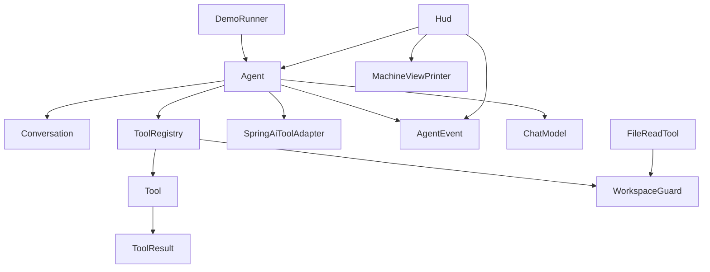

# AGENTS.md — инструкции для AI-агентов

Этот файл описывает проект и правила работы в нём для AI-агентов и других
автоматизированных помощников. Человеку-разработчику тоже стоит начать отсюда.

## Что это за проект

`ai-harness` — учебный кодинг-агент, который живёт в терминале и работает
по локальному репозиторию. Проект растёт от урока к уроку: каждый урок
добавляет одну подсистему (разговор, инструменты, события, HUD, сжатие
контекста и так далее). Поэтому часть кода намеренно недоделана — это
следующие уроки, а не забытый код.

Что уже есть:

- агентский цикл «модель → инструменты → модель» с ограничением числа итераций;
- реестр инструментов и единственный реализованный инструмент чтения файлов `Read`;
- события хода, на которые подписан HUD в стиле T-800;
- грубая оценка размера контекста в токенах.

## Стек и версии

| Что | Значение |
| --- | --- |
| Язык | Java 25 |
| Фреймворк | Spring Boot 4.1.2 |
| LLM-фреймворк | Spring AI 2.0.0 |
| Модель | `qwen3.5:4b` (локальная Ollama) |
| Порт Ollama | `11432` (внутри контейнера `11434`) |
| Сборка | Maven |

Версии зафиксированы в [`pom.xml`](pom.xml:19) и [`application.yaml`](src/main/resources/application.yaml:1).
Проект стоит на Spring AI 2.0 — API из 1.x (например,
`internalToolExecutionEnabled`) выпилен и здесь не используется.

## Команды

Поднять Ollama и скачать модель (нужен NVIDIA Container Toolkit,
см. раздел «Диагностика» в [`README.md`](README.md:1)):

```bash
docker compose up -d
```

Запуск приложения (агент стартует по [`DemoRunner`](src/main/java/ru/harness/DemoRunner.java:16)
и сразу задаёт модели вопрос из кода):

```bash
mvn spring-boot:run
```

Быстрые тесты (без сети и без живой модели, секунды):

```bash
mvn test
```

Полная проверка как в CI — то же самое, что делает
[`build.yml`](.github/workflows/build.yml:1):

```bash
mvn -B verify
```

Тесты на живой модели помечены тегом `ollama` и по умолчанию исключены
(см. `excluded.groups` в [`pom.xml`](pom.xml:21)). Прогнать только их:

```bash
mvn test -Dgroups=ollama -Dexcluded.groups=
```

Эти тесты требуют поднятой Ollama и идут секундами, а не миллисекундами.

## Архитектура

Пакет `ru.harness` смотрит в модели мира так:

- [`agent`](src/main/java/ru/harness/agent/Agent.java:1) — ядро: цикл хода,
  разговор, свойства, события. Ничего не знает про то, как это выглядит на экране.
- [`tool`](src/main/java/ru/harness/tool/Tool.java:1) — контракт инструментов,
  реестр, защита рабочей папки, адаптер под Spring AI.
- [`context`](src/main/java/ru/harness/context/TokenEstimator.java:1) — оценка
  размера контекста.
- [`hud`](src/main/java/ru/harness/hud/Hud.java:1) — представление. Только сюда
  можно импортировать цвета, отступы и метафоры.

Зависимости между пакетами:



Ключевые точки входа:

- [`Agent.run()`](src/main/java/ru/harness/agent/Agent.java:62) — одна порция
  работы: добавить сообщение пользователя, крутить цикл до ответа текстом
  или до предела итераций.
- [`ToolRegistry.execute()`](src/main/java/ru/harness/tool/ToolRegistry.java:38) —
  единственное место, где инструмент реально вызывается.
- [`WorkspaceGuard.resolve()`](src/main/java/ru/harness/tool/WorkspaceGuard.java:22) —
  единственный законный способ превратить строку пути в `Path`.

## Правила и границы

Это договорённости проекта. Их держат тесты и ревью, их же должен уважать
AI-агент при правках:

- **Ошибка инструмента — это результат, а не исключение.** Инструмент
  возвращает [`ToolResult.error(...)`](src/main/java/ru/harness/tool/ToolResult.java:7)
  с текстом, по которому модели видно, что делать дальше.
- **Путь от модели проходит через [`WorkspaceGuard`](src/main/java/ru/harness/tool/WorkspaceGuard.java:11).**
  Наружу рабочей папки не ходим даже по абсолютному пути или через симлинк.
- **Править файл можно только после его чтения** — за этим следит `FileStateCache`.
- **Никакого deprecated API Spring AI 1.x.** Компилятор настроен на
  `-Xlint:deprecation`, предупреждения не игнорируем.
- **Пакет `hud` — только представление.** Ядро агента про него не знает
  и импортировать его не должно. Решение «что показать» живёт в
  [`Hud`](src/main/java/ru/harness/hud/Hud.java:20), решение «как выглядит» —
  в [`MachineViewPrinter`](src/main/java/ru/harness/hud/MachineViewPrinter.java:32).
- **Ядро называет себя техническими именами.** Связь «имя инструмента →
  часть тела Терминатора» живёт в одном месте — [`BodyPart`](src/main/java/ru/harness/hud/BodyPart.java:40).
- **Инструменты исполняет [`ToolRegistry`](src/main/java/ru/harness/tool/ToolRegistry.java:15),
  а не Spring AI.** Его [`SpringAiToolAdapter`](src/main/java/ru/harness/tool/SpringAiToolAdapter.java:25)
  отдаёт модели только описание инструмента, а на вызов бросает исключение.

## Чего не делать

- Не добавлять зависимости без необходимости: каждая едет в сборку ученика.
- Не писать абстракцию раньше её первого потребителя.
- Не трогать `demo/TargetPractice.java` — это мишень для занятий,
  она намеренно недоделана.
- Не расширять пакет `hud` логикой агента и не тянуть его цвета и метафоры
  в ядро.

## Конвенции кода

- Все пакеты помечены `@NullMarked` (JSpecify): по умолчанию значения не-null,
  исключения помечаются `@Nullable` точечно.
- Комментарии и сообщения пользователю — на русском; имена типов и методов —
  на английском.
- Общественный контракт пакета описывается в его `package-info.java`.
- Новый инструмент — это бин, реализующий [`Tool`](src/main/java/ru/harness/tool/Tool.java:5);
  реестр подберёт его сам по `List<Tool<?>>`, а имя для модели должно совпадать
  с тем, что ждёт `BodyPart` и тесты.
